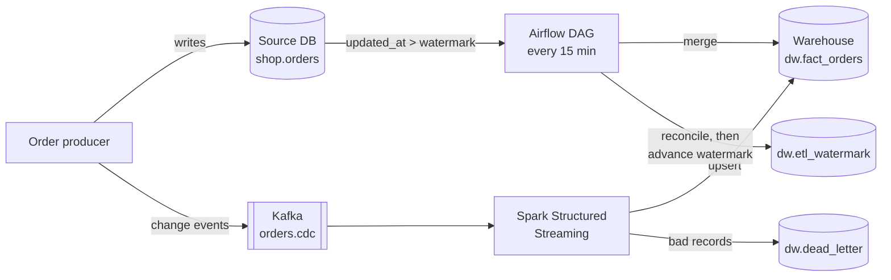

# Orders CDC Pipeline — Kafka · Spark Streaming · Airflow · Postgres

A small, fully local data-engineering project that moves order data from an OLTP
database into a warehouse **two ways**, the same two patterns I use at work:

| Path | How | Pattern |
|---|---|---|
| **Streaming** | Kafka → Spark Structured Streaming → Postgres | CDC-style change events, de-duplication, upserts |
| **Batch** | Airflow DAG, Postgres → Postgres | Timestamp/**watermark incremental load** with **source-to-target reconciliation** |

Both paths share one set of data-quality rules (`pipeline/transforms.py`), which is unit-tested.



## What it demonstrates

- **Change data capture, streaming** – order changes arrive on a Kafka topic; Spark parses them,
  drops replayed events with a watermark-bounded `dropDuplicates`, keeps the latest version of
  each order per micro-batch and **upserts** into the fact table, ignoring events older than what
  is already stored (safe against out-of-order delivery).
- **Incremental batch loads** – the Airflow DAG extracts only rows where
  `updated_at > last watermark`, validates them, merges them into the warehouse and moves the
  watermark forward **only after reconciliation passes**, so a failed run is simply retried.
- **Data quality** – missing keys, unknown statuses, bad amounts/currencies and bad timestamps are
  routed to `dw.dead_letter` with a reason instead of breaking the load.
- **Reconciliation** – extracted = loaded + rejected, and staged rows match the fact table on
  count and amount total.
- **Idempotency** – both paths use `INSERT … ON CONFLICT … WHERE target.updated_at < new.updated_at`,
  so re-running a batch or replaying the stream never duplicates or regresses data.

> The producer simulates the source system and its change feed (it also injects ~2% malformed and
> ~3% duplicate events on purpose). In production the Kafka topic would be fed by a log-based CDC
> tool such as Debezium, IBM InfoSphere CDC or Oracle GoldenGate.

## Run it

Requires Docker with Compose and about 8 GB of free RAM. On Windows, install Docker Desktop (WSL 2 backend).

```bash
docker compose up -d --build
```

| Service | What it does |
|---|---|
| `postgres` | `shop` (source) and `warehouse` databases, created by `sql/00_init.sh` |
| `kafka` | single-node KRaft broker, topic `orders.cdc` |
| `producer` | generates ~5 order events/second |
| `spark-stream` | streaming job (`pipeline/spark_stream.py`) |
| `airflow` | UI at http://localhost:8080 — user `admin`, password from `docker compose exec airflow cat /opt/airflow/standalone_admin_password.txt` |

In Airflow, un-pause **`orders_incremental_load`**.

### Check the results

```bash
docker compose exec postgres psql -U etl -d warehouse
```

```sql
SELECT source, count(*) FROM dw.fact_orders GROUP BY source;   -- rows loaded by each path
SELECT reason, count(*) FROM dw.dead_letter GROUP BY reason;     -- rejected records
SELECT * FROM dw.etl_watermark;                                   -- batch high-water mark
SELECT * FROM dw.v_daily_revenue;                                 -- reporting view
```

Stop with `docker compose down` (add `-v` to wipe the data).

## Tests

```bash
pip install -r requirements-dev.txt
pytest
```

## Layout

```
pipeline/transforms.py              shared validation, dedup, watermark and reconciliation rules
pipeline/spark_stream.py            Kafka -> Spark Structured Streaming -> warehouse
airflow/dags/orders_incremental_load.py   watermark incremental load + reconciliation
producer/order_producer.py          source system + change-event simulator
sql/                                source and warehouse schemas
tests/                              unit tests for the shared rules
```

## Author

**Mohammed Zeeshan** — Data Engineer, Hyderabad ·
[LinkedIn](https://www.linkedin.com/in/zeeshan-mohammed-5370b6230)
